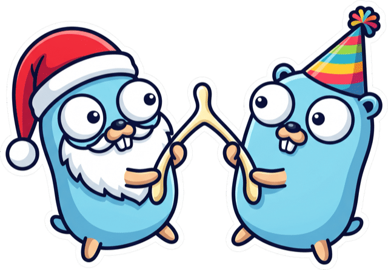
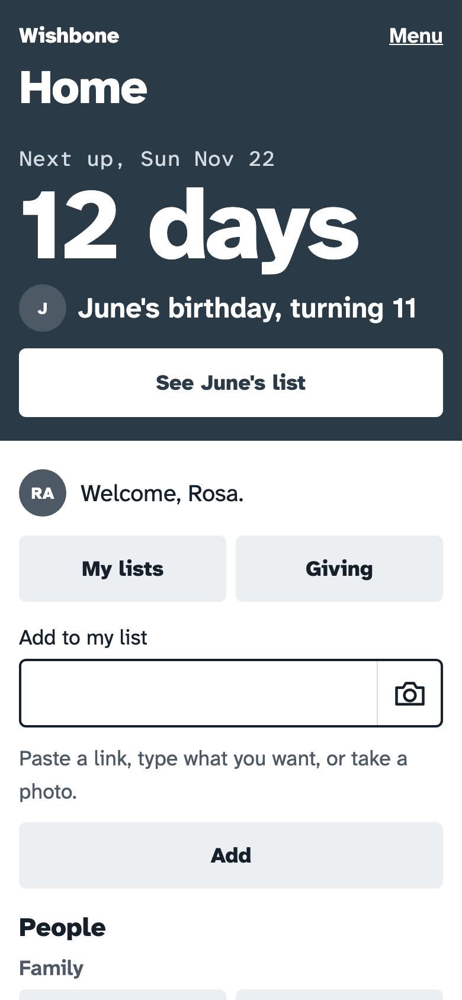
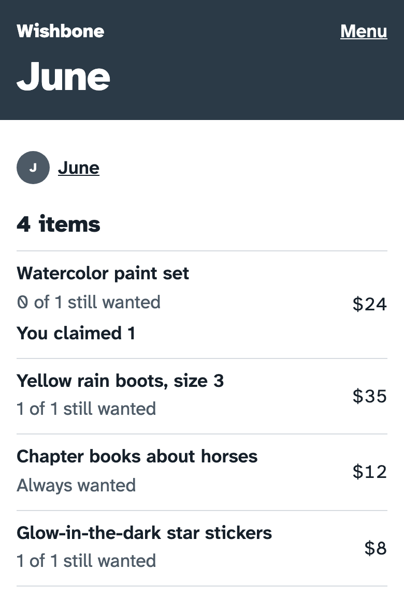
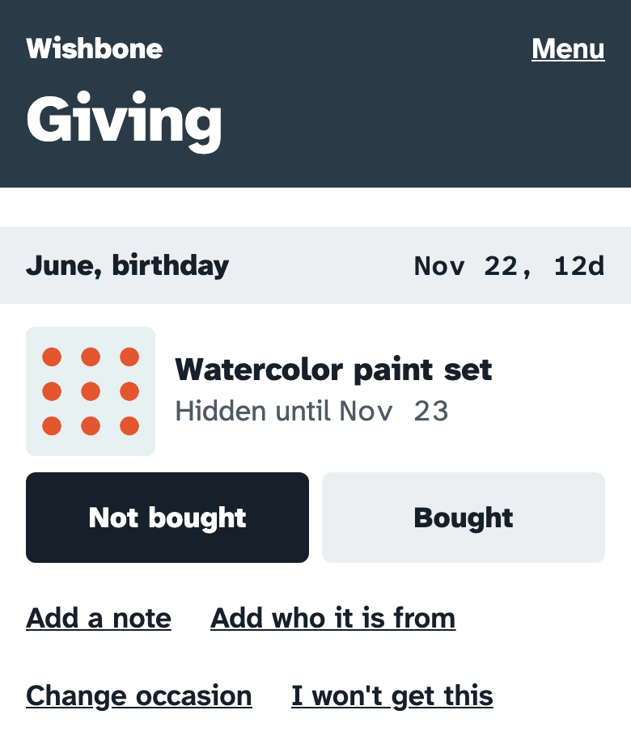

<p align="center">
  
</p>

# wishbone

Private, self-hosted wish lists for a family. One person sets it up. Everyone else gets in by tapping a link or scanning a QR code.

**Status:** One family uses Wishbone every day. Each instance serves one family. There is no hosted version: you run your own, and you are welcome to. One person maintains it, so changes stay small.

- Paste any link, and Wishbone fills in the title, price, and image.
- Recipients never see what is claimed. Once an item is fully claimed, other givers stop seeing it.
- The day after each birthday or shared occasion (such as a holiday), the gifts for it are given, and they show in the recipients' "Received".
- Nested groups and parent links control who sees whose lists across the branches of a family.

<p align="center">
  
  
  
</p>

<p align="center"><em>Home, a list as a giver sees it, and a giver's own claims. The names are made up.</em></p>

Much of Wishbone is written by AI coding agents that the maintainer directs and reviews. [`AGENTS.md`](AGENTS.md) is their guide, and [`docs/workflow.md`](docs/workflow.md) is the process they follow.

See [`docs/spec.md`](docs/spec.md) for the specification, [`GLOSSARY.md`](GLOSSARY.md) for its terms, [`docs/operations.md`](docs/operations.md) to run and back up an instance, and [`docs/development.md`](docs/development.md) to build it.

## Deploy

Wishbone ships as one distroless, multi-arch image, `ghcr.io/jsclayton/wishbone`, with one volume at `/data`. [`docker-compose.yml`](docker-compose.yml) is an example with only the wishbone service.

### Requirements

- Docker with Compose, on an amd64 or arm64 machine.
- A reverse proxy that terminates TLS, such as Caddy, nginx, or Traefik.
- A domain name that serves HTTPS. Passkeys and sign-in cookies need it. The one exception is `localhost`.
- About 100 MB of RAM, and 1 GB of disk to start. The disk grows with the item images and the snapshots (see [Operations](docs/operations.md)).

### Quick start

1. Download the example compose file:

   ```bash
   curl -O https://raw.githubusercontent.com/jsclayton/wishbone/main/docker-compose.yml
   ```

2. Open it, and set `WISHBONE_PUBLIC_URL` to the address people will use in their browser, for example `https://wishbone.example.com`. Set `TZ` to your time zone.
3. Start it:

   ```bash
   docker compose up -d
   ```

4. Point your reverse proxy at `127.0.0.1:8080`. With Caddy, this is the whole config:

   ```caddyfile
   wishbone.example.com {
   	respond /metrics 404
   	reverse_proxy 127.0.0.1:8080
   }
   ```

5. Find the one-time setup code in the log:

   ```bash
   docker compose logs wishbone | grep setup_code | tail -n 1
   ```

   Each start with no users writes a new code, and an older code stops working, so use the last line only.

6. Open your address in a browser, and enter the code with the first user's name and birthday. That user is the admin, and makes the other users in the app.

### Configure

Set the variables in the `environment` block of the compose file. The only required one is `WISHBONE_PUBLIC_URL`, the address people use in their browser. Login links, QR codes, and passkeys use it. The [spec's Configuration table](docs/spec.md#configuration) lists every variable.

- `WISHBONE_TRUSTED_PROXIES`: the CIDRs of your reverse proxy. Set it so rate limits see the real client IP.
- `WISHBONE_LLM_*` and `WISHBONE_BRIGHTDATA_*`: optional link search (the LLM and Bright Data Web Unlocker). Both need an account with a provider, and both cost money: the LLM bills for each call, and Bright Data bills for each page it unlocks. Leave them unset to turn these off. Wishbone then still reads a link directly, without them.
- `OTEL_EXPORTER_OTLP_ENDPOINT` (or `OTEL_EXPORTER_OTLP_TRACES_ENDPOINT`): turns on OpenTelemetry tracing over OTLP/HTTP (`http/protobuf` only; other protocols stop startup). `OTEL_TRACES_EXPORTER=none` turns it off. The other standard `OTEL_*` settings apply. Leave it unset and tracing is off.
- `TZ`: the time zone of the server process, which sets the zone of the times in the logs. It is also the zone of a user who has no timezone (the browser reports one when a user signs in). With no `TZ`, it is UTC.

### Reverse proxy

Run Wishbone behind a reverse proxy that terminates TLS. Cookies are always `Secure`, so sign-in does not work over plain HTTP, except on `localhost`. The proxy must send `X-Forwarded-For`.

`/metrics` serves Prometheus metrics with no sign-in. Don't expose it to the internet. Block the path in your reverse proxy, as the Caddy example does, or scrape it from a private network.

The compose example publishes port 8080 on the host's loopback address only (`127.0.0.1:8080:8080`), so only a proxy on the same host can reach it. A client that could skip the proxy would see `/metrics`, and could send a forged `X-Forwarded-For`. The example also trusts `172.16.0.0/12`, the default Docker network range, which covers a proxy on the host. If the proxy runs in a container on the same Docker network, remove `ports` and let the proxy reach `wishbone:8080`. If it runs on another machine, publish the port on an address that machine can reach, firewall the port so that only the proxy can connect, and set `WISHBONE_TRUSTED_PROXIES` to the proxy's address.

### First start and recovery

A new instance has no users. Each start with no users writes a one-time setup code to the log (`setup_code=...`).

The CLI has `serve`, `users`, `set-admin`, `login-link`, `delete-user`, `backup`, `healthcheck`, and `version`. Run it in the container: `docker compose exec wishbone /app/wishbone users` lists the user IDs, and `docker compose exec wishbone /app/wishbone login-link <user id>` prints a login link that works once and expires after 7 days. `login-link` is the way back in for anyone who lost their sign-in. [`docs/operations.md`](docs/operations.md#commands-in-the-container) lists every command.

### Back up and restore

`wishbone backup` writes a snapshot of the database and images while the server runs:

```bash
docker compose exec wishbone /app/wishbone backup /data/backups/2026-12-01
docker compose cp wishbone:/data/backups/2026-12-01 ./
```

The server doesn't schedule backups. Run the command from cron, and copy the snapshots off the machine. [`docs/operations.md`](docs/operations.md) has the cron line, the restore steps, the snapshots that the server writes before each migration, and the version guard.

### Versions and upgrades

Releases are numbered `MAJOR.MINOR.PATCH`, and each one is an image tag: `ghcr.io/jsclayton/wishbone:2.1.0`, `:2.1`, `:2`, and `:latest`.

- A **patch** release (2.1.1) fixes bugs.
- A **minor** release (2.2.0) adds features. It can add database migrations. It makes only the API changes that the [spec](docs/spec.md#versions-of-the-api) allows within an API version, such as new routes and new fields.
- A **major** release (3.0.0) can need action from you: it can change the database or the configuration, or add a new API version. A new API version is added beside the current one, which keeps working for a while.

Migrations run when the server starts, after it writes a snapshot, and no release undoes one. An older image refuses a database that a newer release migrated, so to go back, restore the snapshot. See [`docs/operations.md`](docs/operations.md#upgrade).

Back up first, then pull and restart:

```bash
docker compose pull
docker compose up -d
```

`:latest` is the highest release, including a new major one. A fix for an older line (such as 1.0.1, after 2.0.0 is out) gets its own tags and leaves `:latest` where it is. To choose when to cross a major version, pin the major (`ghcr.io/jsclayton/wishbone:2`) in place of `latest`: you then get every minor and patch release of it. **Read the [release notes on GitHub Releases](https://github.com/jsclayton/wishbone/releases) before you upgrade to a new major version.**

The server refuses to start on a database that is newer than it knows, or older than the release supports, and says so in its log. Wishbone can't upgrade a database that is older than the release supports: keep running the release that wrote it, or start a new instance with an empty data folder. A new, empty database is never refused.

## License

The code is under the [AGPL-3.0](LICENSE). The name "Wishbone" and the logo are not: see [`TRADEMARKS.md`](TRADEMARKS.md).

```text
Wishbone, private self-hosted family wish lists.
Copyright (C) 2026 John Clayton

This program is free software: you can redistribute it and/or modify
it under the terms of the GNU Affero General Public License as published
by the Free Software Foundation, either version 3 of the License, or
(at your option) any later version.

This program is distributed in the hope that it will be useful,
but WITHOUT ANY WARRANTY; without even the implied warranty of
MERCHANTABILITY or FITNESS FOR A PARTICULAR PURPOSE.  See the
GNU Affero General Public License for more details.

You should have received a copy of the GNU Affero General Public License
along with this program.  If not, see <https://www.gnu.org/licenses/>.
```

The logo adapts the Go gopher, which was designed by Renée French and is licensed under [CC BY 4.0](https://creativecommons.org/licenses/by/4.0/).

## Support

If Wishbone is useful to you, you can [buy me a coffee](https://buymeacoffee.com/jsclayton).
